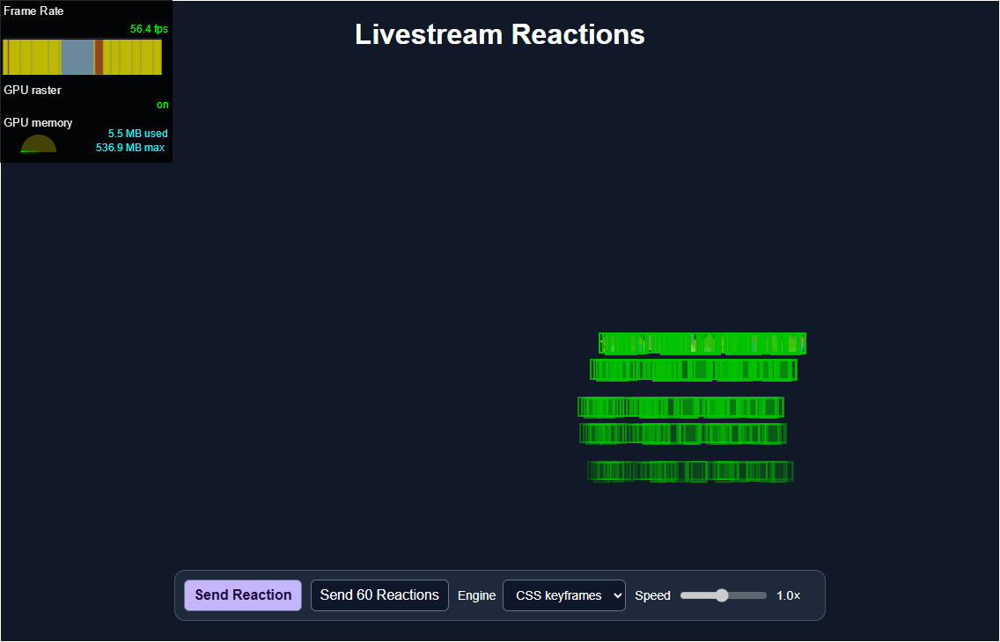
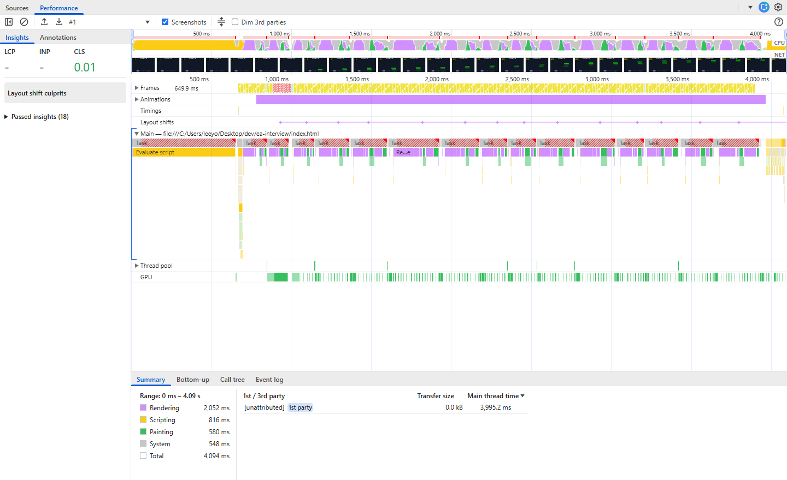
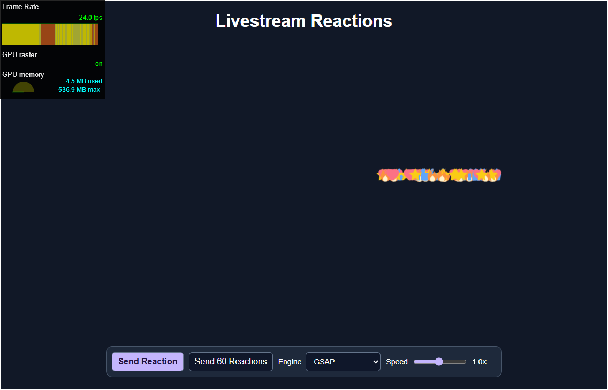
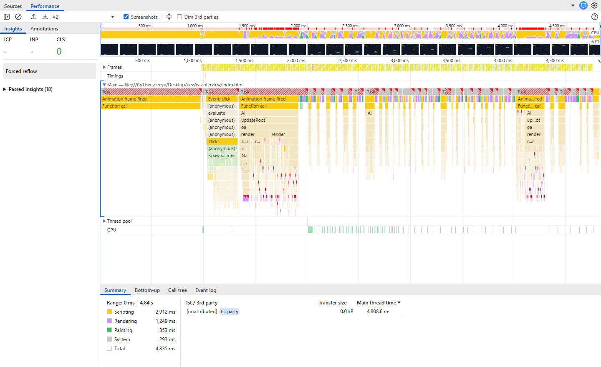

# Livestream Reaction Engine — Submission

## 1. Setup & Running Instructions

1. Open `index.html` in Google Chrome.
2. Choose **CSS keyframes** or **GSAP** under **Engine**. Click **Send Reaction** to see one flight, or **Send 60 Reactions** to test concurrency. Switching engines clears the stage and resets speed to `1.0×` for a fresh run.
3. In **GSAP** mode, move **Speed** to `0.1×` while a burst is rising. The icons continue from their current positions at one tenth speed. At `1.0×`, each flight lasts three seconds. A new flight started at `0.1×` takes about 30 seconds.

To reproduce the comparison, open **Show Rendering** from the DevTools Command Menu and enable **Paint Flashing** and **Frame Rendering Stats**. Open **Performance**, set **CPU** to **6× slowdown** under Capture settings, and record one **Send 60 Reactions** burst in each engine at normal speed. Stop after the icons disappear. Use the same viewport for both recordings and run the slow-motion check separately. 

## 2. Phase 1: CSS Keyframes Analysis

**CSS Paint Flashing**

**CSS Performance Flame Chart**

### Benchmark at 6× CPU slowdown

The reactions looked choppy and DevTools showed substantial paint activity during the initial interactive CSS run. For the comparison below, I re-recorded CSS mode using the final shared SVG assets. Both profiles Chrome browser on Windows, 6× CPU slowdown, Paint Flashing, and Frame Rendering Stats. Each run spawned 60 of the same seeded icons and start positions at `1.0×`. Both runs reached 60 active elements and cleaned up to zero.

### What regions of the screen flashed green during high-concurrency spawning, and why?

`bottom` controls upward travel, `margin-left` controls sway, and `font-size` controls growth. Changing these properties forces Chrome to update the geometry of the moving icons. Those changes can also invalidate pixels where the icons were drawn. The screenshot shows overlapping green rectangles clustered to the right of center, along the reactions' flight paths. The title and control bar show no green in that capture.

### What did the main thread activity (Layout, Recalculate Style, Paint) look like in the flame chart?

During the 60-reaction animation, I noticed many purple and green blocks in the Main thread.

The purple blocks show that Chrome was recalculating styles and layouts to update the icons' positions and sizes. The green blocks show painting work.

Because the CSS animation continuously changes `bottom`, `margin-left`, and `font-size`, Chrome has to repeat these operations during the animation. This increases the workload and can make the animation less smooth.

## 3. Phase 2: GSAP & Composited Rendering Analysis

Both modes now clone the same four SVGs from an HTML template. In GSAP mode, the icon's starting position and size are set when it is created. Its timeline animates `y` and `scale` over three seconds, runs four `x` waypoints for the sway, and animates `opacity` during the last quarter. At completion, the callback removes both the element and its timeline reference. Chrome can composite the transform and opacity updates on the prepared layers while GSAP still uses JavaScript to advance the values. 

**GSAP Paint Flashing**

**GSAP Performance Flame Chart**

### How did the flame chart and frame rate change compared to Phase 1?

- The CSS flame chart shows repeated Layout and Paint throughout the burst. In the GSAP trace, Layout appears once and the main thread spends much less time painting. GSAP's writes still generate style updates, so the flame chart has JavaScript and style work during flight.
- The median gap between `requestAnimationFrame` callbacks fell from **207.1 ms** in CSS mode to **66.7 ms** in GSAP mode during the recordings. GSAP delivered callbacks more often under this workload. The screenshots include momentary FPS overlay readings from separate bursts. The callback gaps measure cadence over the recorded bursts.

### What happened to the green paint invalidation areas once animations moved to composited transforms (`x`, `y`)?
- The GSAP screenshot shows the icons in flight without the green trails visible in the CSS capture. Chrome still has to paint the icons to create their layer contents and can then move, scale, and blend those layers during the flight.

### Mid-flight speed check

In a separate 6× CPU test, I started a 60-reaction GSAP burst at `1.0×`, then changed the slider to `0.1×` while the icons were ascending. All 60 timelines picked up the new speed with no position jump at the change. A sampled icon traveled about 97 px over 400 ms before the change and about 10 px over the next 400 ms. Setting the slider to `2.0×` finished the burst and left zero reaction elements and zero active timelines.

## 4. Architectural Reflection

### Runtime control and developer experience

Css keyfrmes are simple to implement and require no additional libraries, but changing the speed or direction while an animation is running requires extra JavaScript. GSAP is more complex but provides a better developer experience with its timeline and easing features. In the project, the speed slider updates all running animations and also controls the speed of new reactions. If I want to change a reaction's direction while it is moving, I can use its current position as the starting point for a new animation.
### Pipeline Considerations

SVG is more flexible for dynamic themes because we can reuse the same asset and change its color using CSS. PNG sequences may require multiple image variants for different themes and resolutions. However, SVG changes can also trigger repainting, so we should mainly animate transform and opacity for better performance.
